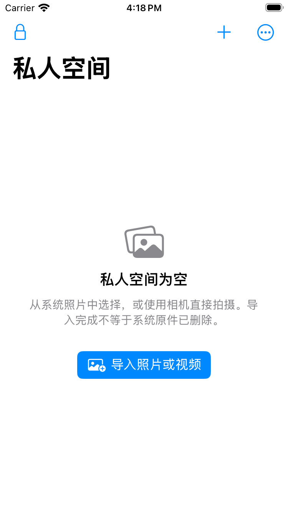

# FocusVault 0.2.0 产品流程与逻辑审计

日期：2026-11-06。目标工程：`隐私相册/FocusVault`，独立于“相册清理”。

## 产品定位与本次范围

核心任务是：解锁私人空间 → 选择照片/视频 → 确认加密副本已保存 → 自主选择是否删除系统原件 → 按相册快速找到并查看 → 随时锁定退出。计时器、秒表是可正常使用的公开工具；公共设置不展示私人空间入口。商店说明和审核访问方法仍如实披露私人空间。

本次保留既有原生系统配色、表单、导航与媒体组件。删除记录页及新增计时记录的写入逻辑，改为秒表；旧版 UserDefaults 计时记录不主动清空。新增相册管理、筛选、全选、连续浏览、快速锁定，并修复数据和生命周期问题。

## 证据与方法

- 在本次工作中重新运行旧版基线 `e575611`，Actions `42062314563` 成功；重新捕获并查看了首次设置、公开首页、空私人空间三张截图，保存在 `release/audit/baseline/`。没有使用历史截图冒充当前审计证据。
- 对 `RootView`、`FocusView`、`VaultView`、`VaultStore`、`SecurityServices`、计时 Store、持久化模型、权限与备份恢复调用链进行源码检查。
- 升级后用 macOS/Xcode 编译与 XCTest 验证，生成小屏与大屏的本轮新截图；最终运行号、通过数和产物 SHA-256 见 `release/README.md`。
- UI 照片示例来自仅在 DEBUG 编译的测试夹具，明确标记为“UI 测试照片”；不会跳过口令，也不进入 Release IPA。不能将这些照片测试当作真实 PhotoKit 权限/相机/大视频验证。

## 主要发现与处理

| 优先级 | 发现及影响 | 本轮处理 |
| --- | --- | --- |
| P1 | 原版在任何非 active 状态立即关闭私人空间；系统权限提示等临时 inactive 状态可能中断导入 | inactive 用 Window 级视图遮挡；background 才清除密钥、私密界面和临时导出。真实后台仍立即锁定 |
| P1 | 备份恢复逐项覆盖媒体，后续遇到缺失项目或写入错误可能留下部分覆盖的原文件 | 先验证整个备份；只写本机不存在的 ID，全部写入完成后一次提交索引；出错清理本轮新文件，同 ID 保留本机状态 |
| P1 | 导入、相册和批量操作先改内存再写索引；写入失败可能让界面与磁盘状态不同 | 索引加密原子写入成功后才发布 items/albums；导入失败撤销新媒体/缩略图，增加写失败测试 |
| P1 | Keychain 更新先删除旧值再添加，添加失败可能丢失旧口令验证信息 | 已有项使用 SecItemUpdate；不存在才新增。创建时先保存媒体密钥，已有私人空间禁止再次覆盖创建 |
| P1 | 永久删除先删媒体再写索引，索引写失败会留下引用不存在文件的项目 | 先提交索引，后清理目标文件；文件清理失败明确提示，下次解锁清理孤立加密文件 |
| P2 | 相册仅从带分类的媒体中派生，无法保留空相册 | 加密索引增加独立相册列表；支持空相册、重命名、删除分类；兼容读取旧数组索引，空相册进入加密备份 |
| P2 | 相册、收藏等入口藏在更多菜单，视频没有真实预览，批量选择缺少全选 | 增加可见筛选栏、相册入口、全选、选中数量；为新视频生成加密预览图；按当前相册直接导入/拍照 |
| P2 | 查看下一张需要返回网格，计时运行时不能通过原入口进入私人空间 | 媒体详情增加上一项/下一项与锁定；时长框在计时中可输入口令并点键盘“确认”，不打断原计时 |
| P2 | 退出依赖顶部按钮，单手操作距离长 | 私人空间首页右滑锁定退出；详情保留原生返回手势并增加锁定按钮；提供 VoiceOver escape 操作 |
| P2 | quiet 口令验证跳过失败限速；损坏备份可能传入无效 PBKDF 次数 | quiet 仅隐藏错误文字，仍受限速约束；普通短分钟数不参与口令验证；备份盐和迭代次数在派生前验证 |
| P2 | 创建备份会整库加载，视频库过大时存在内存峰值 | 本轮加入明确大小检查与提示：备份媒体合计 256 MB，恢复文件 512 MB；流式大视频/分卷备份仍未实现 |

## 用户主流程与便利程度

| 步骤 | 用户操作 | 本轮状态与证据范围 |
| --- | --- | --- |
| 1 | 首次设置数字口令并阅读数据说明 | 保留单页表单；两次确认、防止提示词直接包含口令。双尺寸 UI 测试覆盖首次创建 |
| 2 | 日常使用计时器或秒表 | 记录页改秒表，支持计次、暂停、复位、后台持续和重启恢复；确定性单元测试验证暂停时间不累计 |
| 3 | 输入口令进入私人空间 | 公开首页无私人入口文案；运行中的计时仍可通过数字输入及“确认”进入，原计时保持运行 |
| 4 | 建立空相册、导入当前相册 | “相册”直接进入列表并新建，不需要先有媒体。重命名、删除分类不会删除媒体；名称限 1–40 字符且拒绝重名 |
| 5 | 从系统选择照片/视频并复制 | PhotosPicker 无需先授予整库读写权限，拒绝整库权限不应阻断选取复制；UI 测试覆盖系统选取器打开/取消，照片写入及校验由 Store 测试覆盖 |
| 6 | 自主选择是否删除系统原件 | 仅对已导入成功的资源 ID 提供删除选择；去重并要求全部原件可定位后再向系统提交删除。iCloud、最近删除影响在界面说明；真实权限与删除确认需签名真机 |
| 7 | 分类、收藏、批量选择和连续查看 | 筛选栏、相册、全选、新视频预览、详情上一项/下一项已接入；测试夹具覆盖照片网格和连续浏览，真实视频播放另需真机验证 |
| 8 | 右滑/按钮退出、切后台锁定 | 首页右滑锁定，详情按钮锁定；双尺寸 UI 测试覆盖右滑退出、重新输入口令、后台恢复后仍锁定。Window 遮挡覆盖 modal 的实现经源码核查，系统快照需真机复验 |
| 9 | 最近删除恢复、加密备份与恢复 | 支持全部恢复；永久删除二次确认。单元测试覆盖旧索引、空相册、不同密钥的新私人空间恢复、重复恢复不覆盖、损坏备份不改当前内容 |

Apple 的系统选择器文档明确说明用户仅授权所选项目，不需要照片库读取授权：[PhotosPicker](https://developer.apple.com/documentation/swiftui/view/photospicker%28ispresented%3Aselection%3Amaxselectioncount%3Aselectionbehavior%3Amatching%3Apreferreditemencoding%3Aphotolibrary%3A%29)。删除系统原件仍走独立 PhotoKit 读写授权与系统确认。

## 截图

旧版私人空间没有可见的相册入口，创建分类依赖已有项目的菜单。这张截图只证明界面入口，空相册无法持久化的结论另由旧版 `albums` 派生逻辑确认。

升级版的秒表、相册、媒体详情和后台锁定截图，在最终构建完成后保存于 `release/ui-screens-v020/`；照片为测试夹具。

## 可访问性与适配边界

延续系统语义颜色、动态字体、可滚动布局、原生缩放和系统播放器。筛选按钮提供状态值；锁定、筛选、相册、批量选择和详情前后项均有可理解标签。小屏和大屏 UI 测试不能替代 VoiceOver 实际朗读、最大辅助字号/深色模式逐屏检查，也不构成完整无障碍认证。

## 尚需后续验收

- 已签名 iPhone：权限允许/拒绝/有限照片、iCloud 下载、系统删除及取消、相机、长视频播放和大文件内存峰值。
- 真实系统后台快照与锁屏、应用被终止/低存储条件下的导入和文件保护行为。
- 实际两台 iPhone 间的文件分享与加密备份恢复；单元测试的不同密钥恢复不能替代真机跨设备验收。
- 本版备份为内存格式，超过上限需分别导出视频；大库流式/分卷备份、Live Photo 成对资源完整保存未实现，不宣称原库无损完整迁移。
- 本轮不增加账号、云同步、广告、订阅或第三方分析 SDK；未签名 IPA 仍不能直接安装到普通 iPhone，也未进行 App Store/TestFlight 审核提交。
